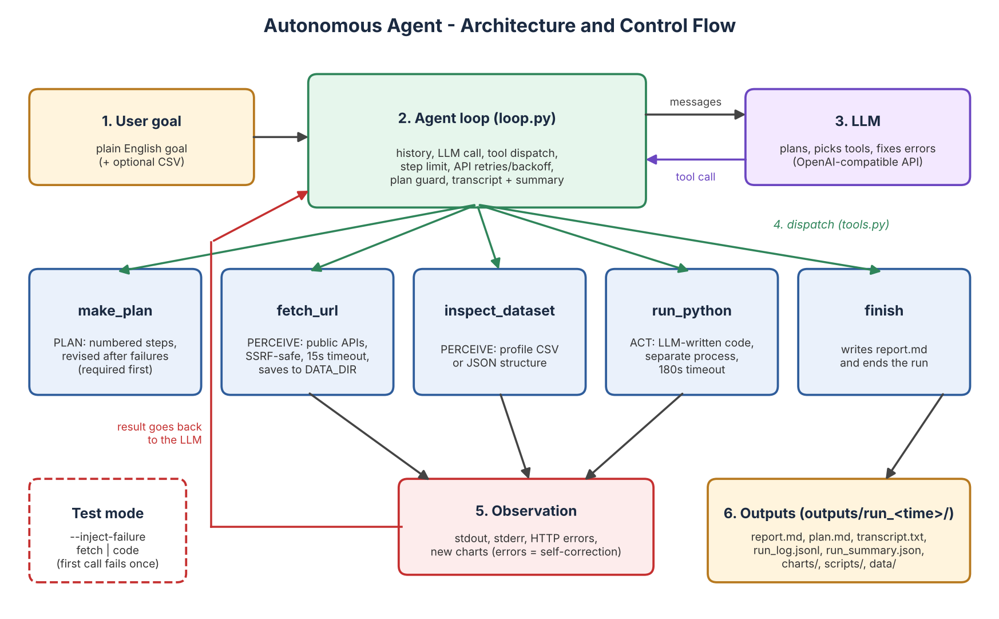

# Autonomous Analyst Agent

An AI agent that takes a high-level goal in plain English and works on its own: it writes a **visible plan**, gathers data (from a CSV you provide, or live from public APIs), runs its own Python code, **recovers from failures**, and delivers a Markdown report with charts plus a JSON run summary.

No answers or rules are hard-coded. Every decision (what to plan, which tool to call, how to fix an error, when to finish) comes from an LLM. The code only provides tools, safeguards and a loop.



## How it works

| Stage | What happens |
|---|---|
| Plan | The agent must call `make_plan` first (other tools refuse until a plan exists). The numbered plan is printed and saved to `plan.md`. After a failure it can revise the plan. |
| Perceive | `fetch_url` pulls live data from public APIs (no key needed for many). `inspect_dataset` profiles a CSV or the structure of a JSON file. |
| Act | `run_python` executes LLM-written code in a separate process with a timeout and returns stdout/stderr/charts. |
| Self-correct | Errors and suspicious output go back to the LLM, which diagnoses, retries or revises its plan. |
| Finish | The LLM decides when it has enough evidence and calls `finish` with the report. |

It is a plain Python tool-calling loop (the ReAct pattern) with no agent framework, so every line is readable in `agent/`.

## Project structure

```
autonomous-data-agent/
├── main.py                # command-line entry point
├── agent/
│   ├── loop.py            # reasoning loop, retries, step limit, transcript + run summary
│   ├── tools.py           # the 5 tools, plan guard, failure injection
│   ├── web.py             # safe HTTP fetching (public addresses only, no auto-redirects)
│   ├── sandbox.py         # runs generated code in a subprocess with a timeout
│   └── prompts.py         # system prompt
├── tests/                 # pytest suite (no API key or internet needed)
├── sample_data/           # synthetic sales.csv and the script that made it
├── example_output/        # saved sample runs
├── outputs/               # one folder per run
├── architecture_diagram.png
├── requirements.txt / requirements-dev.txt
└── .env.example
```

## Installation

Requires Python 3.10 or newer.

1. Get the code and open a terminal in the project folder:
   ```bash
   git clone https://github.com/HarshitKalra04/autonomous-data-agent.git
   cd autonomous-data-agent
   ```
2. Create and activate a virtual environment:
   ```bash
   python -m venv venv
   venv\Scripts\activate          # Windows
   source venv/bin/activate       # Mac/Linux
   ```
3. Install dependencies:
   ```bash
   pip install -r requirements.txt
   ```
4. Create your settings file: copy `.env.example` to `.env` and fill in your key.

   The agent uses the OpenAI-compatible chat API, so these providers work by changing only these lines:

   | Provider | LLM_BASE_URL | LLM_MODEL (example) |
   |---|---|---|
   | OpenAI | *(leave empty)* | `gpt-4o-mini` |
   | Google Gemini | `https://generativelanguage.googleapis.com/v1beta/openai/` | `gemini-3.1-flash-lite` |
   | Groq | `https://api.groq.com/openai/v1` | `llama-3.3-70b-versatile` |
   | Ollama (local) | `http://localhost:11434/v1` | any tool-capable model |

   The model must support tool/function calling. A free Gemini key can be created at aistudio.google.com (API keys page). Free tiers have daily request limits, so pick a model with enough requests per day (`gemini-3.1-flash-lite` works well). `STEP_DELAY` in `.env` (default 4 seconds) spaces out requests to stay under per-minute limits.

## Usage

**1. Goal with a CSV file:**
```bash
python main.py --data sample_data/sales.csv --goal "Find what drives units sold and summarize the top 3 insights"
```

**2. Goal with live data (no CSV, the agent sources data itself):**
```bash
python main.py --goal "Using the free Open-Meteo API (https://api.open-meteo.com, no key needed), compare the average daily maximum temperature over the past 7 days in Delhi, Mumbai and Bengaluru, and tell me which city was warmest."
```

**3. Deliberately induced failure (to see recovery):**
```bash
python main.py --inject-failure fetch --goal "Using the free Open-Meteo API (https://api.open-meteo.com, no key needed), compare the average daily maximum temperature over the past 7 days in Delhi, Mumbai and Bengaluru, and tell me which city was warmest."
```
`--inject-failure fetch` makes the first `fetch_url` call fail with a timeout; `--inject-failure code` makes the first `run_python` call crash. The failure is injected once, clearly marked `[INDUCED FAILURE]` in the transcript, and the agent has to notice and recover.

Other options: `--max-steps 15`, `--model NAME`, `--step-delay SECONDS`, `--out outputs`.

## What each run produces

Each run creates `outputs/run_<timestamp>/`:

| File | Content |
|---|---|
| `transcript.txt` | the full console trace: plan, actions, results, failures |
| `plan.md` | every plan version, including revisions and their reasons |
| `report.md` | the final structured report, with a factual run log (plan versions, tool calls, every failure) appended automatically by the framework |
| `run_summary.json` | structured result: steps, tool-call counts, failures, plan versions, tokens, duration |
| `run_log.jsonl` | every tool call with arguments, result and a failure/induced flag |
| `charts/`, `scripts/`, `data/` | charts, every script the agent ran, and fetched data files |

## Example runs

Saved runs are in `example_output/`, each with its transcript, plan, report and summary:

- `run1_csv_analysis/` - goal on a CSV file
- `run2_live_api/` - goal solved with live data from a public API
- `run3_induced_failure/` - same goal with an induced failure and the agent's recovery

## Tests

```bash
pip install -r requirements-dev.txt
pytest
```
The suite covers the URL safety checks (against a real local HTTP server), every tool, the plan guard, failure injection, the code sandbox timeout, and the full agent loop using a scripted fake LLM. No API key or internet is needed.

## Safeguards

- **Plan guard:** tools refuse to run until the agent has written a plan.
- **Step limit:** the loop stops after `--max-steps`, and the agent is told when its last step arrives.
- **Timeouts:** generated code is killed after 180 seconds; HTTP requests after 15 seconds.
- **Safe fetching:** only public http(s) addresses (localhost, private and link-local addresses are blocked), redirects are not followed automatically, responses are capped at 2 MB, and saved file names are sanitised.
- **Error recovery:** tool errors and bad JSON arguments go back to the LLM, which adapts. Temporary API failures (rate limits, server errors) are retried with increasing waits; permanent ones (a wrong key or model name) stop immediately with a clear message.
- **Output truncation:** long outputs are shortened so the LLM context is not flooded.

## Assumptions and mock data

- `sample_data/sales.csv` is **synthetic**, made by `sample_data/make_sample.py` with deliberate problems (25 missing values, 3 outliers). It is used only for the CSV demo and tests.
- Live data comes from public APIs at run time; nothing is pre-downloaded.
- The `--inject-failure` flag is a test feature that simulates a failing tool; it is off by default.

## Limitations

- The sandbox is process isolation with a timeout, not a hardened sandbox. Run the agent only on data and with models you trust; do not expose it to untrusted users.
- Live data depends on public APIs being up and on the LLM knowing their URL formats.
- Each code run is a fresh process, so the LLM reloads data each time.
- Report quality depends on the model you choose. Weak models make weaker analyses.
- Statistical findings are exploratory, not proof of causation.

## Originality

All code in this repository was written for this project. It uses only the standard OpenAI Python SDK, pandas, numpy, matplotlib and python-dotenv (plus pytest for tests).
