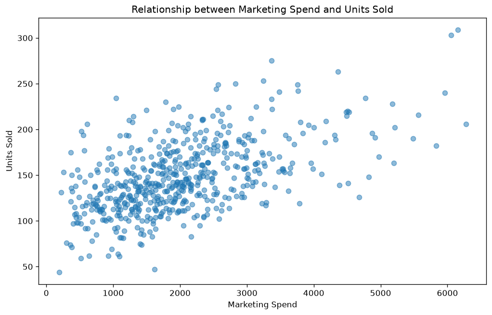
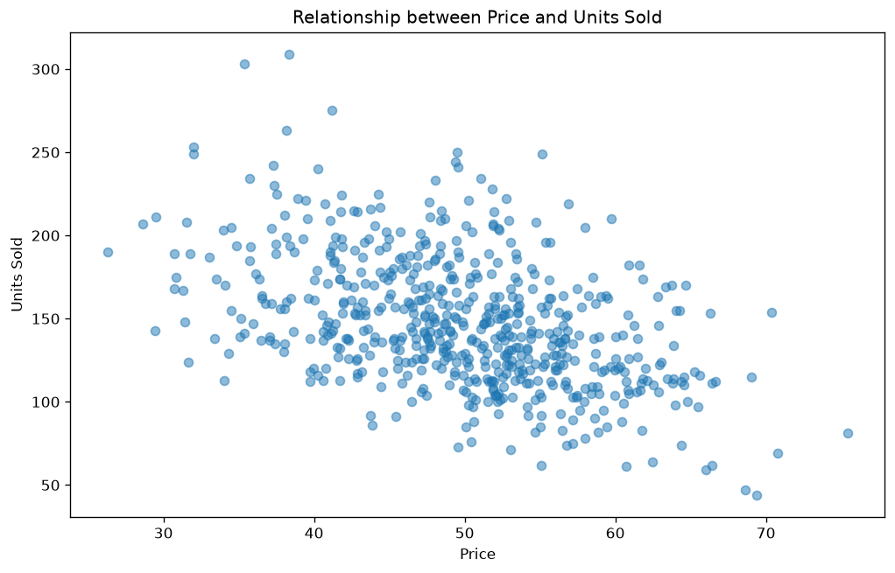

# Sales Performance Analysis Report

## Summary
The analysis identified key drivers of unit sales using a multivariable linear regression model. After removing outliers (specifically, three entries with 5,000 units sold that were inconsistent with the rest of the data), the model achieved an **R-squared of 0.88**, indicating that the selected features explain 88% of the variation in units sold.

## Data Quality Notes
- **Outliers:** Three records had `units_sold` values of 5,000, which were significantly higher than the median of 142. These were excluded from the regression analysis to avoid skewing the results.
- **Missing Values:** `marketing_spend` had 25 missing values (out of 600 total rows), which were imputed using the median for the regression analysis.

## Key Findings

The following table summarizes the estimated impact of each driver on `units_sold`:

| Driver | Coefficient (Impact on Units Sold) |
| :--- | :--- |
| **Intercept** | 217.90 |
| **Marketing Spend** | +0.02 units per dollar |
| **Discount Percentage** | +3.10 units per percent |
| **Price** | -2.14 units per dollar |

### Top 3 Insights

1.  **Marketing Spend is the strongest predictor:** Every additional dollar spent on marketing is associated with an increase of approximately 0.02 units sold.
2.  **Price sensitivity is significant:** Increasing the price by $1 is associated with a decrease of roughly 2.14 units sold.
3.  **Regional variance exists:** Sales performance differs by region compared to the baseline (East region). Being in the South region is associated with 43.5 fewer units sold than in the East region, controlling for other factors.

## Visualizations

## Assumptions and Limitations
- **Correlation vs. Causation:** The findings show associations between variables, not direct causation.
- **Linearity:** The model assumes linear relationships between the predictors and units sold, which may not capture complex non-linear dynamics.
- **Outlier Handling:** The extreme values of 5,000 units were treated as data errors or anomalies and excluded. If these values represent valid, high-impact events, the model's predictive power for such events is limited.
