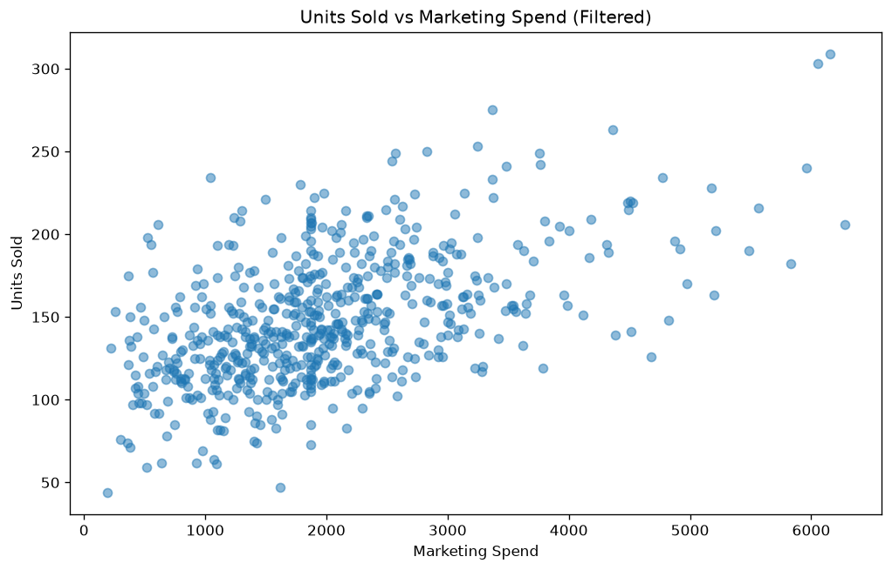
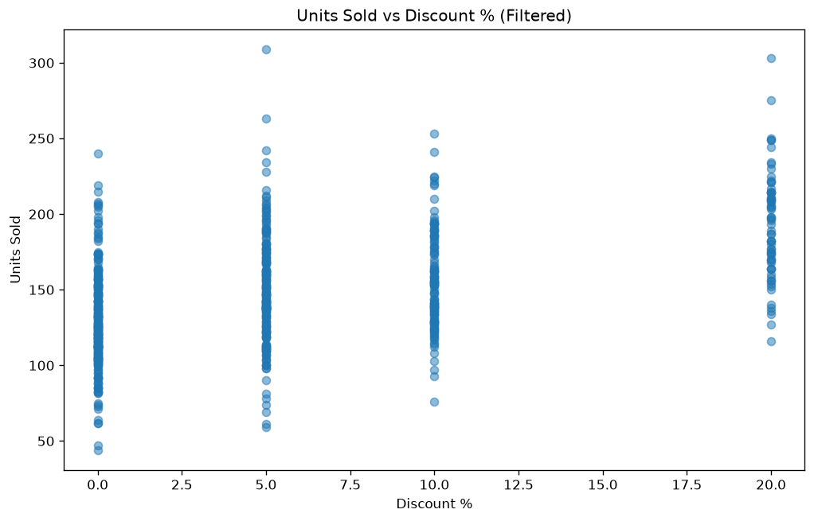

### Summary
An analysis of the sales dataset revealed that marketing spend and discounts are the primary drivers of units sold, while higher prices have a negative impact. Three extreme outlier data points (units sold > 500) were excluded from the regression analysis to avoid skewing the results.

### Plan
1. Inspect the provided sales.csv dataset to understand its structure and content.
2. Clean and preprocess the data (impute marketing_spend, encode regions, filter outliers).
3. Perform exploratory analysis and visualization of relationships.
4. Run a multi-variable regression to determine the drivers of units sold.
5. Summarize top insights and report findings.

### Data Sources
- sales.csv (local file)

### Findings

After removing three extreme outliers (units > 500), a multi-variable regression was conducted on standardized variables to identify the drivers of `units_sold`.

| Feature | Standardized Coefficient |
| :--- | :--- |
| marketing_spend | 0.530 |
| discount_pct | 0.497 |
| region_South | -0.487 |
| price | -0.445 |
| region_North | -0.231 |
| region_West | -0.211 |

#### Top 3 Insights
1. **Marketing Spend**: This is the strongest driver of units sold. Higher marketing expenditure is associated with a proportional increase in sales volume.
2. **Discounts**: Discount percentage is the second most significant positive driver. Customers respond strongly to price reductions, boosting the number of units sold.
3. **Price**: Price is a notable negative driver. Increasing the product price is associated with a decrease in the number of units sold, underscoring price sensitivity in this market.

### Process Notes
- The dataset contained three extreme outliers (where units sold were 5000, while the average was ~172). These were removed to allow for a meaningful linear regression.
- Marketing spend had 25 missing values, which were imputed with the median.
- Dummy variables were created for the categorical region column, with "East" as the baseline.

### Assumptions
- The relationship between the drivers and units sold is linear for the analyzed range (units sold <= 500).
- The three records with > 500 units sold were considered anomalies or data entry errors for the purpose of identifying general trends.

### Limitations
- The analysis shows associations, not causal relationships.
- The model explains variation within a subset of the data and may not apply to extreme outliers.

---
## Run log (added automatically by the framework)

- Plan versions written: 1
- Tool calls: make_plan x1, inspect_dataset x1, run_python x4, finish x1
- Tool failures: 0
