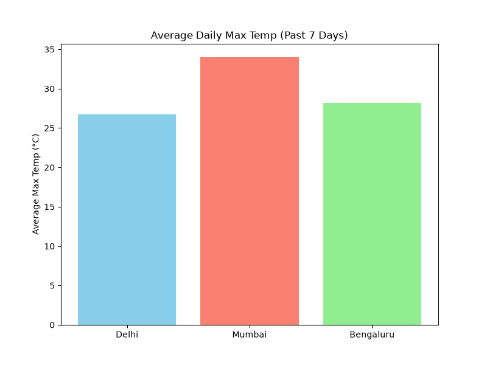

### Summary
The objective was to compare the average daily maximum temperature over the past 7 days in Delhi, Mumbai, and Bengaluru using the Open-Meteo API. The analysis reveals that Mumbai was the warmest city among the three, with an average daily maximum temperature of 34.0°C.

### Plan Followed
1.  Fetched historical weather data for Delhi, Mumbai, and Bengaluru for the last 7 days using the Open-Meteo API.
2.  Parsed the JSON responses to extract daily maximum temperatures.
3.  Calculated the average daily maximum temperature for each city.
4.  Identified the warmest city based on the calculated averages.
5.  Generated a summary report with a supporting bar chart.

### Data Sources
- [Open-Meteo API](https://api.open-meteo.com): Retrieved forecast data including historical records.

### Findings

| City | Average Max Temp (°C) |
| :--- | :--- |
| Delhi | 26.74 |
| Mumbai | 34.00 |
| Bengaluru | 28.24 |

The analysis shows that **Mumbai** was the warmest city during the 7-day period.

### Process Notes
- The initial data fetch was successful. 
- A slight issue with file path referencing (DATA_DIR vs 'data' directory) was encountered, which was resolved by accessing the 'data' directory directly. 
- The temperature calculation used the first 7 entries of the 'temperature_2m_max' array provided by the API, corresponding to the requested past 7 days.

### Assumptions & Limitations
- The temperatures represent daily maxima as provided by the Open-Meteo API.
- The analysis assumes the "past 7 days" corresponds to the first 7 data points in the returned 'temperature_2m_max' array.
- The study is limited to the accuracy of the Open-Meteo forecast data.

---
## Run log (added automatically by the framework)

- Plan versions written: 1
- Tool calls: make_plan x1, run_python x7, fetch_url x3, finish x1
- Tool failures: 3
  - Step 6, run_python: FileNotFoundError: [Errno 2] No such file or directory: 'DATA_DIR\\delhi.json'
  - Step 7, run_python: FileNotFoundError: [WinError 3] The system cannot find the path specified: 'DATA_DIR'
  - Step 8, run_python: FileNotFoundError: [Errno 2] No such file or directory: 'delhi.json'
