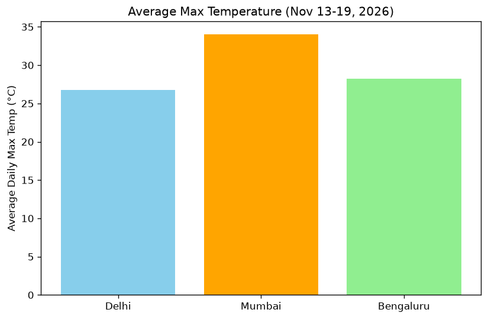

### Summary
An analysis of daily maximum temperatures in Delhi, Mumbai, and Bengaluru for the past 7 days (November 13th to November 19th, 2026) was conducted. Mumbai was identified as the warmest city, with an average daily maximum temperature of 34.00°C.

### Plan
1. Calculate the date range for the past 7 days (2026-11-13 to 2026-11-19).
2. Fetch historical weather data for Delhi, Mumbai, and Bengaluru for the specified range using Open-Meteo API (fetched per-city to avoid timeouts).
3. Extract the daily maximum temperature for each city from the JSON responses.
4. Calculate the average daily maximum temperature for each city over the 7-day period.
5. Compare the averages, identify the warmest city, and compile the final report.

### Data Sources
- [Open-Meteo API](https://api.open-meteo.com) (Historical Forecast Weather Data)

### Findings
Over the period from November 13 to November 19, 2026, the average daily maximum temperatures were as follows:

| City | Average Daily Max Temp (°C) |
| :--- | :--- |
| **Mumbai** | **34.00** |
| Bengaluru | 28.24 |
| Delhi | 26.74 |

Mumbai was significantly warmer than both Bengaluru and Delhi during this week.

### Process Notes
- Step 1: Initial attempt to fetch all data in a single request timed out. 
- Step 2: Revised plan to fetch data for each city individually using separate calls, which succeeded.
- All calculations were verified using Python.

### Assumptions and Limitations
- The period defined as "past 7 days" was calculated as 2026-11-13 to 2026-11-19 relative to the provided current date of 2026-11-20.
- Data is sourced directly from Open-Meteo's historical forecast archive.
- The analysis assumes the "daily maximum temperature" accurately represents the daily heat profile of the cities for the specified timeframe.

---
## Run log (added automatically by the framework)

- Plan versions written: 2
- Tool calls: make_plan x2, fetch_url x4, run_python x2, finish x1
- Tool failures: 1
  - Step 2, fetch_url (induced on purpose to test recovery): ERROR: request timed out after 15s (no response from server).
